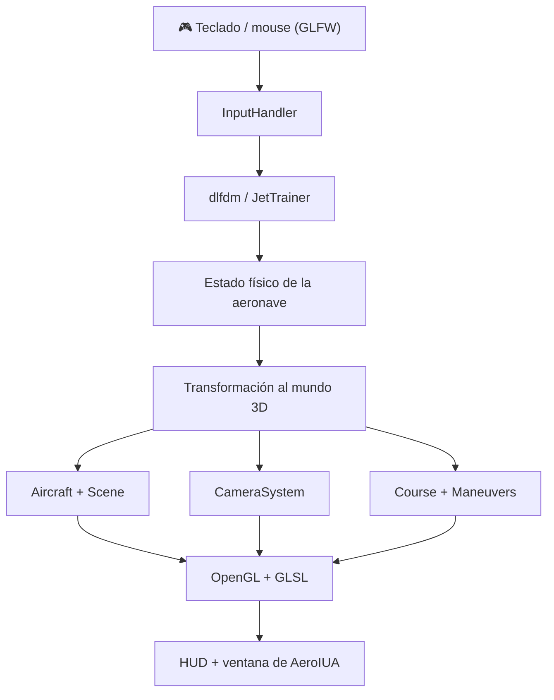

<a id="inicio"></a>

<div align="center">

# ✈️ AeroIUA: Mateando en las nubes 🧉

### 🎮 Una escuela de vuelo virtual sobre los cielos de Córdoba

**Proyecto Integrador · Computación Gráfica y Ambientes Virtuales · 2026**

[](https://isocpp.org/)
[](https://www.opengl.org/)
[](https://www.khronos.org/opengl/wiki/OpenGL_Shading_Language)
[](https://ubuntu.com/)
[](#estado)
[](#estado)

**[🚀 Instalación](#instalacion) · [🕹️ Controles](#controles) · [🏗️ Arquitectura](#arquitectura) · [🧪 Pruebas](#pruebas)**

</div>

---

## 🌤️ ¿Qué es AeroIUA?

**AeroIUA: Mateando en las nubes** es un **simulador de vuelo 3D interactivo**, desarrollado en **C++17 y OpenGL** para el proyecto integrador de la materia *Computación Gráfica y Ambientes Virtuales*.

La experiencia propone pilotear una aeronave de entrenamiento sobre una **representación esquemática del entorno del IUA (Córdoba, Argentina)**, atravesar aros, practicar maniobras y sumar puntos. La visualización gráfica se combina con el modelo físico **`dlfdm`**, provisto por la cátedra, para calcular la evolución de la aeronave.

> [!IMPORTANT]
> **Es un prototipo académico, no un simulador certificado.** Ni el escenario ni la dinámica fueron validados para entrenamiento u operación aeronáutica real.

### 🎯 Objetivos académicos

- Aplicar geometría y transformaciones 3D en tiempo real.
- Renderizar una escena con **OpenGL**, **GLSL** y modelos geométricos.
- Implementar **cámaras dinámicas** e interacción con teclado y mouse.
- Integrar un **modelo de dinámica de vuelo (FDM)**.
- Diseñar un proyecto **modular, extensible y mantenible**.
- Construir una experiencia interactiva con **HUD, objetivos y puntuación**.

## ✨ Funcionalidades destacadas

| Funcionalidad | Descripción |
|---|---|
| ✈️ **Vuelo interactivo** | Control de elevador, alerones, timón y potencia del motor. |
| 🛩️ **Modelo físico** | Uso del `JetTrainer` del motor `dlfdm`; evolución de fuerzas y estados de vuelo. |
| 🎥 **3 cámaras** | Cabina, seguimiento con órbita/zoom y tomas cinematográficas. |
| 🧭 **HUD** | Indicadores de velocidad, potencia, aceleración, objetivos y puntuación. |
| 🏁 **Circuito de vuelo** | Cinco aros que deben cruzarse en orden; el siguiente objetivo se resalta. |
| 🏆 **Maniobras** | Detección de tonel y looping mediante el estado y la trayectoria simulada. |
| ⏯️ **Menú y pausa** | Jugar, continuar, reiniciar y salir; pausa sin alterar el estado del FDM. |
| 🕓 **Ritmo de simulación** | Cambio entre `SIM 0.6X` y `SIM 1X`. |
| 🧱 **Modo wireframe** | Visualización de mallas para observar la geometría. |
| 🚧 **Límites básicos** | Detección de contacto con el suelo y salida del área de vuelo. |

### 🏆 Objetivos y puntuación

| Objetivo | Puntos |
|---|---:|
| 🟡 Atravesar un aro activo | **+100** |
| 🔄 Completar un tonel detectado | **+250** |
| 🎢 Completar un looping detectado | **+250** |
| 🏁 Cinco aros + ambas maniobras | **1.000** puntos posibles |

**Colores de los aros:** 🟡 amarillo = objetivo actual · 🔵 celeste = pendiente · ⚫ gris = completado.

> La detección de maniobras está implementada, pero su presencia **no garantiza** que la aeronave pueda ejecutarlas físicamente en todas las condiciones de vuelo.

---

## 🧰 Tecnologías utilizadas

| Tecnología | Uso en el proyecto |
|---|---|
| **C++17** | Lógica principal, módulos y simulación. |
| **OpenGL 4.6 / GLSL 4.60** | Renderizado de geometría, iluminación básica y HUD. |
| **GLFW** | Ventana gráfica, teclado, mouse y contexto OpenGL. |
| **GLM** | Vectores, matrices, ángulos y transformaciones 3D. |
| **GLAD** | Carga de funciones OpenGL (**incluido en el repositorio**). |
| **dlfdm / JetTrainer** | Dinámica física de la aeronave (**incluido en el repositorio**). |
| **GNU Make / GCC / G++** | Compilación del programa. |

<a id="instalacion"></a>

## 🚀 Instalación y ejecución local

> Instrucciones orientadas a **Ubuntu 24.04 LTS y distribuciones Debian/Ubuntu compatibles**. Se necesita un entorno de escritorio activo y una GPU/controlador capaz de crear un **contexto OpenGL 4.6 Core**. La compatibilidad con Windows/macOS no fue validada para esta versión.

### 1️⃣ Instalar dependencias

Abrí una terminal y ejecutá:

```bash
sudo apt update
sudo apt install -y \
  git build-essential make pkg-config mesa-utils \
  libglfw3-dev libglm-dev libgl1-mesa-dev \
  libx11-dev libxrandr-dev libxi-dev libxcursor-dev libxinerama-dev
```

**No hace falta instalar GLAD ni `dlfdm` por separado:** sus fuentes forman parte del proyecto.

### 2️⃣ Comprobar compatibilidad gráfica

```bash
glxinfo -B
```

Buscá `OpenGL core profile version string` y verificá que indique **4.6 o superior**. Si el sistema solo ofrece OpenGL 4.5, esta versión del programa no cumple el requisito gráfico, aunque la compilación termine correctamente.

### 3️⃣ Clonar el repositorio

```bash
git clone https://github.com/kyanesdev/CG-y-AV-2026.git
cd CG-y-AV-2026/Proyecto-Integrador
```

> Si ya descargaste el repositorio como ZIP, extraelo y abrí una terminal **dentro de `Proyecto-Integrador/`**. No se requieren rutas absolutas ni carpetas especiales en tu equipo.

### 4️⃣ Compilar y ejecutar

```bash
make -j"$(nproc)"
make run
```

¡Listo! Si se cumplen las dependencias y los requisitos gráficos, se abrirá la ventana de **AeroIUA** con el menú inicial.

**Alternativa:** desde el directorio `Proyecto-Integrador/` también podés ejecutar:

```bash
./bin/aeroiua
```

**Para limpiar y recompilar:**

```bash
make clean
make -j"$(nproc)"
make run
```

<details>
<summary>📁 ¿Estoy parado en la raíz del repositorio y no en el integrador?</summary>

También podés compilar y ejecutar sin cambiar de directorio:

```bash
make -C Proyecto-Integrador -j"$(nproc)"
make -C Proyecto-Integrador run
```

El juego carga los shaders mediante rutas relativas a `assets/`; por eso es importante iniciarlo desde la carpeta `Proyecto-Integrador/` o utilizar `make -C ... run`.

</details>

---

<a id="controles"></a>

## 🕹️ Controles de vuelo

### ✈️ Pilotaje

| Tecla | Acción |
|---|---|
| `↑` / `↓` | Elevador: cabeceo de la aeronave. |
| `←` / `→` | Alerones: alabeo izquierda/derecha. |
| `Shift` + flechas | Mayor deflexión de los mandos para maniobras. |
| `A` / `D` | Timón de dirección. |
| `W` / `S` | Aumentar / reducir la potencia del motor. |

> 💡 La potencia responde rápidamente, pero la velocidad **no cambia de forma instantánea**: se calcula a partir del modelo físico. El HUD muestra la potencia (`POT`), velocidad (`VEL`) y aceleración (`ACC`).

### 🎥 Cámaras y visualización

| Tecla / acción | Función |
|---|---|
| `1` | Cámara de cabina. |
| `2` | Cámara de seguimiento. |
| `3` | Cámara cinematográfica. |
| `3` nuevamente | Cambiar a otra toma cinematográfica. |
| `Mouse izquierdo` + arrastrar | Orbitar la cámara de seguimiento. |
| `Mouse derecho` + arrastrar | Acercar o alejar la cámara de seguimiento. |
| `F` | Activar/desactivar el modo *wireframe*. |
| `T` | Alternar entre `SIM 0.6X` y `SIM 1X`. |

### ⏯️ Menú y partida

| Tecla | Función |
|---|---|
| `P` / `Espacio` | Pausar o reanudar el vuelo. |
| `Esc` durante el vuelo | Abrir el menú y pausar. |
| `↑` / `↓` dentro del menú | Cambiar la opción seleccionada. |
| `Enter` | Confirmar `JUGAR`, `CONTINUAR`, `REINICIAR` o `SALIR`. |
| `Esc` dentro del menú | Salir del programa. |

**Importante:** el menú muestra `JUGAR` antes de la primera partida y `CONTINUAR` después de comenzar. Para reiniciar se usa **únicamente `REINICIAR` en el menú**; la tecla `R` no reinicia el vuelo. Después de tocar suelo o salir de los límites del escenario es obligatorio reiniciar.

---

<a id="arquitectura"></a>

## 🏗️ Arquitectura del proyecto

El integrador organiza el renderizado, la simulación y la interacción en módulos diferenciados.

```text
Proyecto-Integrador/
├── 📁 assets/
│   └── shaders/                 # Shaders GLSL 4.60
├── 📁 libs/
│   └── dlfdm/                   # Motor de dinámica de vuelo
├── 📁 third_party/
│   └── glad/                    # Carga de funciones OpenGL
├── 📁 src/
│   ├── main.cpp                 # Ventana, bucle principal y estados
│   └── modules/
│       ├── Aircraft.*           # Aeronave y geometría
│       ├── CameraSystem.*       # Tres modos de cámara
│       ├── Course.*             # Circuito y checkpoints
│       ├── Hud.*                # Instrumentos, puntaje y menú
│       ├── InputHandler.*       # Entradas de teclado y mouse
│       ├── Maneuvers.*          # Detección de maniobras
│       ├── Mesh.*               # Gestión de mallas
│       ├── Primitives.*         # Primitivas geométricas
│       ├── ResourceManager.*    # Recursos gráficos
│       ├── Scene.*              # Terreno y escena
│       ├── SchoolFlightSettings.h # Ajustes didácticos del FDM
│       └── Shader.*             # Gestión de shaders
├── 📁 tests/                     # Pruebas numéricas y de módulos
├── Makefile
├── Makefile.master
└── README.md
```

### 🔄 Flujo general de ejecución



### 🔬 Algunos detalles técnicos

- **Paso de física fijo:** `1/120 s` para actualizar el FDM.
- **Condición inicial del FDM:** configuración `ISA5000TAS150`, aproximadamente 5.000 m de altitud y 150 m/s.
- **Representación en pantalla:** el estado inicial se transforma para mostrar el avión aproximadamente a 120 m sobre el terreno esquemático, sin sustituir el estado interno del FDM.
- **Respuesta didáctica de potencia (v0.6):** en la instancia del videojuego se escalan conjuntamente el empuje máximo y ciertos coeficientes de arrastre por `2.0`. Esto hace más perceptible la respuesta a `W/S` sin modificar las ecuaciones originales de `dlfdm`. **No constituye una calibración aeronáutica real.**
- **Checkpoints:** se valida el cruce del segmento de movimiento con el plano del aro activo, dentro de un radio definido.

---

<a id="pruebas"></a>

## 🧪 Pruebas y validación

Las pruebas se ejecutan desde `Proyecto-Integrador/`.

**🔢 Orientación y continuidad angular** (requiere Python 3):

```bash
python3 tests/test_orientation_math.py
```

**⚙️ Ajustes del modelo de vuelo** (requiere `g++` y las dependencias de compilación):

```bash
g++ -std=c++17 -Ilibs/dlfdm/include \
  tests/test_school_settings.cpp \
  libs/dlfdm/src/dlfdm/models/aircraft/jettrainer.cpp \
  -o /tmp/aeroiua-settings-test

/tmp/aeroiua-settings-test
```

**🎯 Detectores de maniobras** (trayectorias sintéticas):

```bash
g++ -std=c++17 -Ilibs/dlfdm/include \
  tests/test_maneuvers.cpp src/modules/Maneuvers.cpp \
  -o /tmp/aeroiua-maneuvers-test

/tmp/aeroiua-maneuvers-test
```

> Estas pruebas verifican componentes concretos: **no reemplazan** una sesión de vuelo completa ni certifican las maniobras o el modelo aerodinámico.

### 🧯 Solución de problemas frecuentes

| Problema | Qué revisar |
|---|---|
| No abre la ventana / error de GLFW | Que exista una sesión gráfica y soporte OpenGL 4.6 Core. Ejecutá `glxinfo -B`. |
| `GLFW/glfw3.h: No such file` | Instalá `libglfw3-dev`. |
| `glm/...: No such file` | Instalá `libglm-dev`. |
| Error de enlace con `-lGL`, `-lglfw` o X11 | Verificá los paquetes de desarrollo indicados en instalación. |
| No encuentra los shaders | Ejecutá con `make run` **dentro de `Proyecto-Integrador/`**. |
| Quedan objetos de una compilación anterior | Ejecutá `make clean` y compilá nuevamente. |

---

<a id="estado"></a>

## 🗺️ Estado del proyecto

**Versión actual: `v0.6` — primera versión funcional y estable para su evolución académica.**

### ✅ Implementado

- [x] Escenario 3D con representación esquemática del entorno del IUA.
- [x] Aeronave controlable mediante el modelo `JetTrainer`.
- [x] Tres modos de cámara.
- [x] HUD, menús y pausa.
- [x] Cinco checkpoints secuenciales con puntuación.
- [x] Detectores de tonel y looping.
- [x] Modo wireframe y ritmo temporal alternable.
- [x] Detección básica de contacto con suelo y límites del escenario.

### 🔭 Limitaciones y evolución posible

- [ ] Mejorar la fidelidad visual y geográfica del campus.
- [ ] Ampliar las colisiones y el comportamiento de aterrizaje.
- [ ] Validar las maniobras completas en condiciones de vuelo reproducibles.
- [ ] Incorporar requisitos de las próximas entregas de la materia.
- [ ] Evaluar, **a futuro**, una interfaz de comunicación por red para interoperabilidad con un entrenador físico. **No está implementada actualmente.**

---

## 👨‍💻 Autor y contexto académico

| | |
|---|---|
| 👤 **Autor** | **Kevin Leonel Yanes** |
| 🎓 **Carrera** | Ingeniería Informática |
| 🏛️ **Institución** | CRUC — Instituto Universitario Aeronáutico (IUA) |
| 📚 **Materia** | Computación Gráfica y Ambientes Virtuales |
| 📍 **Ubicación** | Córdoba, Argentina 🇦🇷 |
| 📆 **Año** | 2026 |
| 🔗 **GitHub** | [@kyanesdev](https://github.com/kyanesdev) |

Este proyecto se desarrolla con fines **educativos**, integrando conceptos de programación gráfica, arquitectura de software e interacción con modelos físicos.

### 📜 Licencias y agradecimientos

- El componente **`dlfdm`**, de Diego Llorens y utilizado en la cátedra, se distribuye bajo **licencia MIT**. Consultá [`libs/dlfdm/LICENSE`](libs/dlfdm/LICENSE).
- **GLAD** y las demás dependencias de terceros conservan sus respectivas condiciones de licencia.
- **El código propio de AeroIUA todavía no tiene una licencia general definida.** Que el repositorio sea público no implica autorización automática para copiarlo, redistribuirlo o integrarlo en otros proyectos. El alcance de una eventual colaboración deberá acordarse previamente.

---

<div align="center">

### ☁️ ¡Nos vemos en los cielos de AeroIUA! ✈️🧉

**Hecho con C++, gráficos 3D, muchas pruebas y unos buenos mates.**

[⬆️ Volver al inicio](#inicio)

</div>
