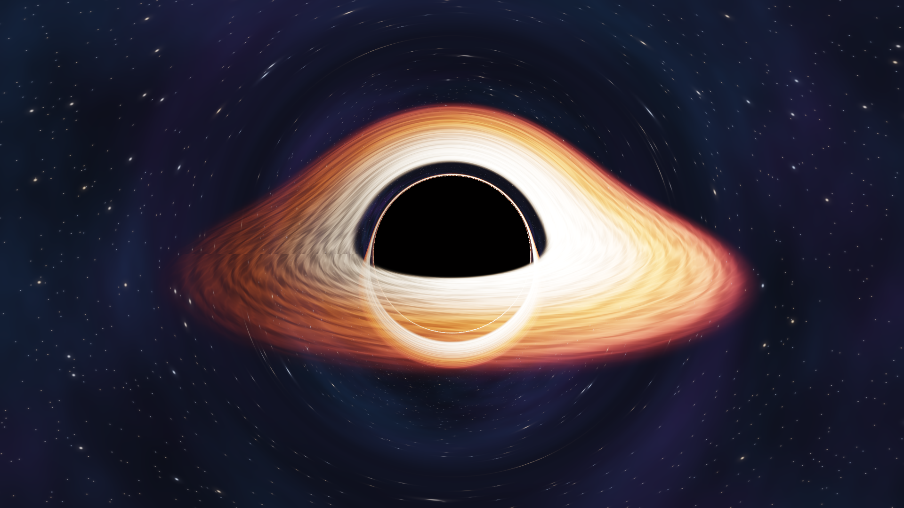

# 🎮 Computación Gráfica y Ambientes Virtuales — 2026


## 📚 Descripción del proyecto

Repositorio académico de la materia **Computación Gráfica y Ambientes Virtuales (CGyAV)**, correspondiente a la carrera de **Ingeniería Informática** del **Centro Regional Universitario Córdoba (CRUC)**, perteneciente al **Instituto Universitario Aeronáutico (IUA)**, Córdoba, Argentina.

El propósito de este repositorio es documentar y desarrollar los contenidos prácticos de la asignatura, aplicando los conceptos fundamentales de la computación gráfica mediante programación en **C++**, la API **OpenGL** y el lenguaje de sombreado **GLSL**.

El desarrollo se realiza siguiendo los contenidos, las consignas y las herramientas indicadas por la cátedra.

## 👨‍💻 Datos del alumno

| Campo | Información |
|---|---|
| **Alumno** | Kevin Leonel Yanes |
| **Carrera** | Ingeniería Informática |
| **Institución** | CRUC — IUA |
| **Ubicación** | Córdoba, Argentina 🇦🇷 |
| **Año académico** | 2026 |
| **GitHub** | [@kyanesdev](https://github.com/kyanesdev) |

## 🎯 Objetivos de la materia

Comprender y aplicar los fundamentos teóricos y prácticos de la computación gráfica y los ambientes virtuales.

Los objetivos de este repositorio son:

- 📐 Comprender la representación y el procesamiento de geometría.
- 🎨 Trabajar con el pipeline gráfico de OpenGL.
- 💻 Desarrollar aplicaciones gráficas en C++.
- 🖥️ Implementar shaders utilizando GLSL.
- 📦 Administrar recursos gráficos y archivos mediante módulos reutilizables.
- 🧮 Aplicar los conceptos matemáticos necesarios para la representación gráfica.
- ✈️ Integrar los conocimientos de la asignatura en un trabajo práctico final.

## 🛠️ Tecnologías y herramientas

| Tecnología | Utilización |
|---|---|
| **C++17** | Lenguaje principal de programación |
| **OpenGL 4.6** | API de computación gráfica |
| **GLSL 4.60** | Programación de shaders |
| **GLFW** | Creación de ventanas y gestión de eventos |
| **GLAD** | Carga de funciones de OpenGL |
| **GLM** | Operaciones matemáticas para gráficos |
| **GCC / G++** | Compilación de código C y C++ |
| **GNU Make** | Automatización de compilaciones |
| **Visual Studio Code** | Entorno de desarrollo |
| **Ubuntu 24.04 LTS** | Sistema operativo de desarrollo |
| **Git / GitHub** | Control de versiones |

## 📂 Organización del repositorio

El repositorio se divide en proyectos independientes, de acuerdo con las actividades prácticas de la materia.

```text
CGyAV/
├── README.md
├── .gitignore
└── Practico/
    ├── Proyecto-basico/
    │   └── ogl-project-template-revAgo26/
    │       └── ogl-project-template/
    │
    ├── Guia-1/
    │   ├── Parte-1-Triangulo/
    │   └── Parte-2-ResourceManager/
    │
    └── ...
```

La estructura se ampliará progresivamente conforme se desarrollen las siguientes guías de ejercicios.


## 📖 Guías de trabajos prácticos

| Guía | Contenido | Estado |
|---|---|---|
| **Guía 01** | Introducción a OpenGL y GLSL. Primer triángulo y ResourceManager en C++17 | ✅ Completada |
| **Guía 02** | Mallas indexadas, VAO, VBO, EBO y construcción de un cubo | ✅ Completada |
| **Guía 03** | Primitivas paramétricas, normales y transformaciones geométricas | ✅ Completada |
| **Guía 04** | Composición de una aeronave mediante primitivas y transformaciones | ✅ Completada |
| **Guía 05** | Cámara orbital, matrices de vista y proyección perspectiva | ✅ Completada |
| **Guía 06** | Game loop, controles de vuelo e integración del Flight Dynamics Model (FDM) | ✅ Completada |


## ✈️ Trabajo práctico integrador

Como proyecto integrador se contempla el desarrollo de una **simulación gráfica de vuelo de un avión mediante OpenGL**.

El propósito será integrar los conocimientos adquiridos durante la materia y representar gráficamente los elementos necesarios para una experiencia de simulación de vuelo.

Su alcance, funcionalidades y arquitectura se definirán de acuerdo con las consignas de la cátedra y los contenidos efectivamente estudiados.

El desarrollo priorizará la comprensión de los conceptos y la capacidad de explicar cada componente implementado.

## 🌌 Módulo adicional — Ray Tracing por software (CPU)

Como actividad complementaria de la materia, se desarrolló una aplicación en **C++17** que genera una imagen de un agujero negro supermasivo inspirado en **TON 618**, utilizando la técnica de **Ray Tracing por software**, ejecutada íntegramente mediante el procesador (CPU).

El objetivo es comprender cómo se construye una imagen mediante el trazado de rayos, relacionando la implementación con los conceptos de **cámara virtual, proyección perspectiva, vectores, superficies visibles y cálculo de colores** abordados durante la asignatura.

### 🔭 ¿Cómo funciona?

El programa genera una imagen de **1920 × 1080 píxeles** mediante los siguientes pasos:

1. 📷 **Cámara virtual:** establece el punto de observación y la dirección de los rayos.
2. 📐 **Trazado de rayos:** calcula un rayo por cada muestra de la imagen utilizando operaciones vectoriales.
3. 🕳️ **Agujero negro:** representa el horizonte de eventos como una región oscura que absorbe los rayos.
4. 💫 **Desviación gravitacional:** aproxima la curvatura de las trayectorias de luz alrededor del agujero negro.
5. 🔥 **Disco de acreción:** calcula los colores y efectos luminosos del material que rodea al agujero negro.
6. 🎨 **Imagen final:** determina el color de cada píxel y genera un archivo PNG.

A diferencia de **NVIDIA RTX**, que utiliza aceleración por hardware, este proyecto implementa el trazado de rayos directamente en la **CPU**, sin requerir una tarjeta gráfica dedicada ni OpenGL.

> **Nota académica:** La representación está inspirada en TON 618 y utiliza aproximaciones visuales de los efectos gravitacionales. No constituye una simulación astrofísica exacta.

### 🖼️ Resultado obtenido



### 🚀 Compilación y ejecución

```bash
cd Imagen-Ray-Tracing/AgujeroNegro
make
make render
xdg-open renders/AgujeroNegro.png
```

📂 **[Ver código fuente, documentación y explicación técnica del módulo](Imagen-Ray-Tracing/README.md)**

**Conceptos aplicados:** Ray Tracing, vectores, rayos, cámara perspectiva, visibilidad, iluminación, color y generación de imágenes mediante CPU.

## 🧠 Metodología de aprendizaje

El desarrollo de cada trabajo práctico sigue una secuencia de aprendizaje:

1. Analizar la consigna oficial de la guía.
2. Identificar los conceptos teóricos necesarios.
3. Diseñar una solución acorde con los contenidos de la materia.
4. Implementar el código en C++ y, cuando corresponda, OpenGL/GLSL.
5. Compilar, ejecutar y verificar los resultados.
6. Comprender y documentar las decisiones de implementación.

El objetivo no es solamente obtener un programa funcional, sino también **entender cómo funciona y poder justificar técnicamente su implementación**.


## 🎓 Información académica

Este repositorio tiene fines exclusivamente académicos y educativos.

Los ejercicios se desarrollan a partir del material proporcionado por la cátedra de Computación Gráfica y Ambientes Virtuales. Los componentes de terceros y los templates suministrados conservan sus respectivas condiciones de uso y atribuciones.

**Desarrollado por Kevin Leonel Yanes** 🇦🇷

Ingeniería Informática — CRUC IUA — 2026

🔗 [GitHub — kyanesdev](https://github.com/kyanesdev)
